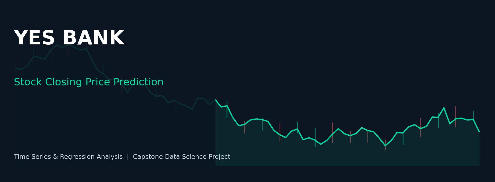

# 🏦 Yes Bank Stock Closing Price Prediction



**Project by: Santosh Kumar**
*Masters in Data Science — Capstone Project*

## 📋 Project Summary

Yes Bank is a well-known private sector bank in the Indian financial domain. Since 2018, it has
been in the news because of the fraud case involving its co-founder, Rana Kapoor. This project
studies the monthly stock price behaviour of Yes Bank since its inception (July 2005) through
November 2020, and builds regression models to **predict the stock's monthly closing price**
using Open/High/Low prices and engineered historical features.

The full analysis — EDA (20 charts), feature engineering, model building (Linear Regression,
Ridge, Lasso, Random Forest), evaluation and business conclusions — lives in the Jupyter /
Google Colab notebook at:

📓 [`notebooks/Yes_Bank_Stock_Closing_Price_Prediction.ipynb`](notebooks/Yes_Bank_Stock_Closing_Price_Prediction.ipynb)

## 📂 Repository Structure

```
yesbank-stock-closing-price-prediction/
├── README.md
├── requirements.txt
├── data/
│   └── data_YesBank_StockPrices.csv     # Monthly OHLC stock price data (Jul-2005 to Nov-2020)
├── notebooks/
│   └── Yes_Bank_Stock_Closing_Price_Prediction.ipynb   # Full, executed, error-free notebook
├── images/
│   ├── cover_banner.png
│   └── 01_closing_price_trend.png
└── reports/
    └── Yes_Bank_Stock_Prediction_Final_Report.docx      # Full written project report
```

## 🚀 How to Run

### Option A — Google Colab (recommended)
1. Open Google Colab: https://colab.research.google.com
2. `File → Upload notebook` and select `notebooks/Yes_Bank_Stock_Closing_Price_Prediction.ipynb`
3. Upload `data/data_YesBank_StockPrices.csv` into the Colab session (or mount Google Drive)
4. `Runtime → Run all`

### Option B — Locally
```bash
git clone https://github.com/<your-username>/yesbank-stock-closing-price-prediction.git
cd yesbank-stock-closing-price-prediction
pip install -r requirements.txt
jupyter notebook notebooks/Yes_Bank_Stock_Closing_Price_Prediction.ipynb
```

## 🧪 Methodology

1. **Data Understanding & Cleaning** — parsing dates, checking nulls/duplicates
2. **Exploratory Data Analysis** — trend, distribution, seasonality, volatility, correlation,
   pairplot, candlestick-style chart (20 charts total)
3. **Feature Engineering** — lag features (`Prev_Close`, `Prev_Open`), rolling averages
   (`MA_3`, `MA_6`), High-Low spread, time features
4. **Modeling** — chronological train/test split; Linear Regression, Ridge, Lasso, Random Forest
5. **Evaluation** — R², MAE, RMSE, MAPE, residual analysis
6. **Explainability** — Random Forest feature importance
7. **Conclusion** — business insights on the impact of the 2018 fraud case on the stock price

## 🛠️ Tech Stack
Python · Pandas · NumPy · Matplotlib · Seaborn · Scikit-learn · Jupyter / Google Colab

## ✅ Results (Summary)
All four models achieve a strong R² on held-out months since Open/High/Low are tightly
correlated with Close. See the notebook's Section 8 (Model Building) and Section 9
(Feature Importance) for full metrics, comparison charts, and discussion.

## 📄 License
This project is released for educational purposes as part of an AlmaBetter Masters in Data
Science capstone submission.

---
**Author:** Santosh Kumar
